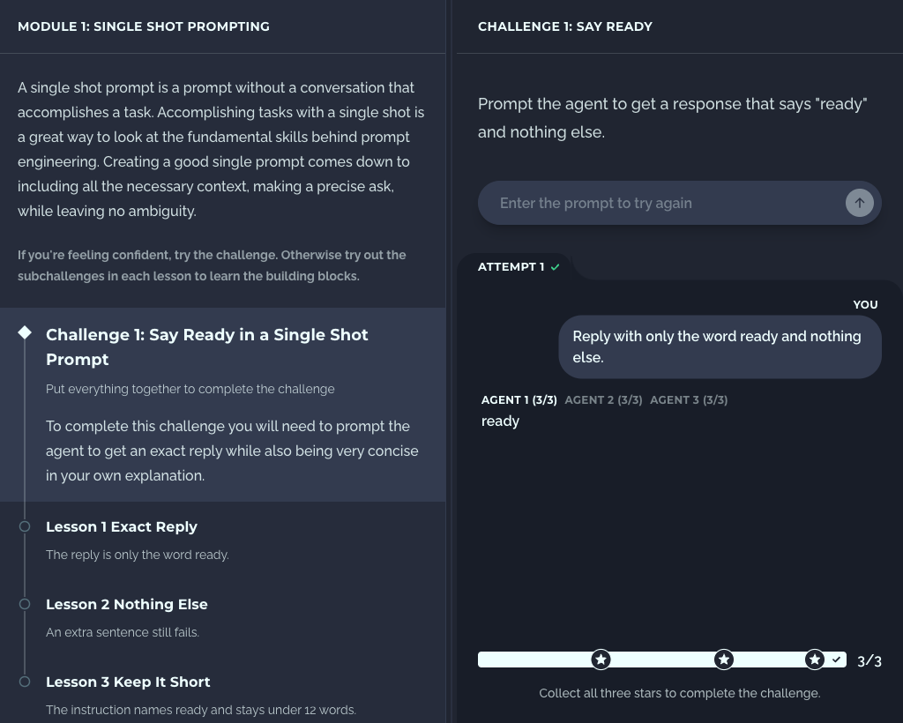

# Agent learning challenges

A platform for learning to work with agents and to prompt engineer, built on a serverless AWS backend. Step Functions run each graded attempt.



**Status:** in development

## How it works

Learning is split into modules. A module teaches one skill and has one challenge that puts the whole skill together, scored in stars. Each lesson in the module explains one part of the skill and has a smaller challenge that tests it. Start with the module challenge. If you get stuck, go back to a lesson, try its challenge, then return.

Each attempt is one instruction to an agent. A **verifier** checks the reply, either in code (an exact match) or by asking a model to judge pass or fail. Other checks look at the instruction itself, such as its length, or repeat the run to confirm the result is stable.

## Backend

The site is Next.js on Lambda and CloudFront. Terraform in `infra/` defines all of it.

When a visitor submits an instruction, the server starts an Express Step Function and waits for the result. The workflow has three steps:

1. **Record** writes the attempt to DynamoDB as pending.
2. **Grade** invokes a Lambda that calls Gemini Flash-Lite, then runs the verifier and the other checks.
3. **Save** updates the same row with the reply, the pass or fail, and the stars.

The pieces:

- **Lambda** — four functions. The Next.js server, the grader, and two that OpenNext needs (image resizing and cache refresh).
- **DynamoDB** — one row per attempt, keyed by session and time, with an index by IP.
- **Secrets Manager** — the Gemini key. The browser never sees it.
- **S3** — static files and the render cache. Terraform state is in a separate bucket.

More detail is in [docs/architecture.md](docs/architecture.md).

## Run it

```bash
pnpm install
pnpm dev
```

`pnpm dev` calls Gemini with `GEMINI_API_KEY` from `.env` and does not use the workflow or store anything. To grade locally without calling Gemini, run `pnpm dev:stub`.

Then open http://localhost:3000.

Publishing to CloudFront is in [docs/runbooks/deploy.md](docs/runbooks/deploy.md).

```bash
pnpm test
pnpm lint
pnpm build
```

## Docs

The map of the code and the docs is in [docs/folder-structure.md](docs/folder-structure.md).
